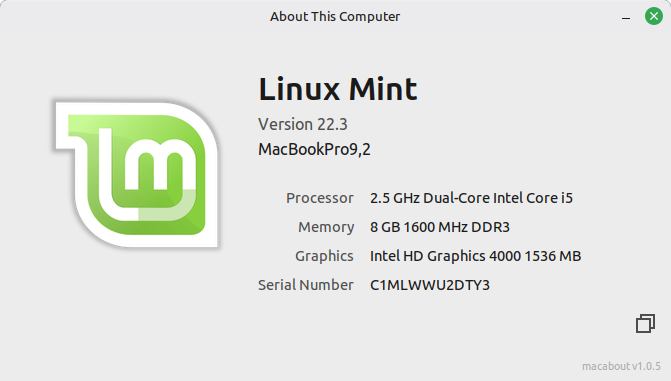
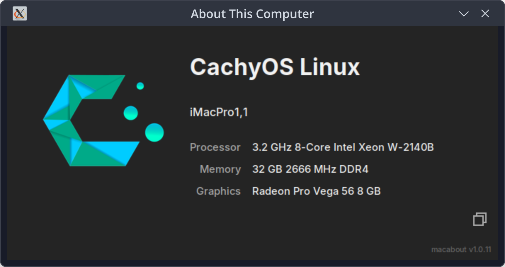

# macabout

`macabout` presents your Linux machine's hardware in the same format as macOS ("About this Mac...")

If you're on a re-purposed Mac and need to see a simple system summary, this makes complete sense.

| Linux Mint | CachyOS |
|:---:|:---:|
|  |  |

## Installing on Linux

### Quick install (one-line)

This detects & installs the package for the running distro (debian or arch based)

```bash
curl -sSL https://pandawood.github.io/macabout/install.sh | bash
```

On Debian (eg Ubuntu/Mint) it fetches the `.deb` and on Arch distros (eg CachyOS/Omarchy) it builds the `PKGBUILD`.

> An AUR package (`paru -S macabout`) was planned... but new accounts were banned at the time of writing...

## Compatibility

macabout reads system information from standard Linux interfaces and therefore works on any modern Linux distro (x86_64 or ARM64). Only the **packaging** is distro-specific:

| Distro family                        | What the installer does                      |
|--------------------------------------|----------------------------------------------|
| Debian, Ubuntu, Mint, Zorin…         | Installs the `.deb`                          |
| Arch, CachyOS, Manjaro, EndeavourOS… | Builds the `PKGBUILD`                        |
| Fedora, openSUSE, …                  | Not packaged - run from source (see below)   |

macabout never needs root: everything it reads is readable by any user.

## Why?
I use old Macs with Linux installed and system-info is not presented in the same way; so I found it slightly annoying to understand exactly what Mac I have. Just annoying enough to crack out Claude Code and finally do something useful with it, for probably 10% of users ;-)

Having a Mac isn't compulsory for `macabout` to work - it's compatible with any hardware, but might not make as much sense.

## What macabout shows

| Field | Source | Example output |
|---|---|---|
| Distro name | `/etc/os-release` (`NAME`) | Zorin OS |
| Version | `/etc/os-release` (`VERSION`, parenthesised suffix stripped) | Version 17.1 |
| Machine model | `/sys/class/dmi/id/product_name` (unlabelled line; hidden if absent or OEM placeholder) | MacBook Air (13-inch, Mid 2013) |
| Processor model | `/proc/cpuinfo` (`model name`), cleaned up by family | Intel Xeon W |
| Processor speed | `/proc/cpuinfo` (`@ X.Y GHz` in model name) | 3.2 GHz |
| Core count | `/proc/cpuinfo` - unique `(physical id, core id)` pairs | 8-Core |
| Memory size | `/proc/meminfo` (`MemTotal`), nearest GB | 8 GB |
| Memory speed/type | udev's copy of the firmware's memory table (`udevadm info /sys/class/dmi/id`) | 1600 MHz DDR3 |
| Graphics | `lspci -nn` PCI ID → bundled `gpu_lookup.json`; falls back to parsed `lspci` name + AMD sysfs VRAM | Radeon Pro Vega 56 8 GB |

Memory speed/type needs systemd 248 or later (Ubuntu 22.04, Debian 12 and newer); without it the dialog shows the memory size alone.

## Running from source (devs or deviants)

This is also the path for anyone not on a Debian or Arch distro... Replace `apt` command with your package manager's equivalent.

You'll need a Rust toolchain ([rustup](https://rustup.rs)) as well as `pciutils`.

```bash
git clone https://github.com/PandaWood/macabout.git
cd macabout
sudo apt install pciutils
make test            # optional: run the test suite
make mock            # static Zorin OS sample data (good for UI work)
cargo build --release
target/release/macabout
```

`macabout --text` prints the summary instead of opening the window.

Up to 1.0.10 macabout was written in Python; that version is the `v1.0.10` tag.

## Distro icon

The icon is fetched from the system's own branding, which varies, so we came up with these checks, in this order:

1. The system's own icon (PNG or SVG), tried by name in this order:
   - `LOGO=` field in `/etc/os-release` (explicit XDG icon name - most authoritative)
   - `distributor-logo` (FreeDesktop standard, present on most distros)
   - `distributor-logo-{id}`, `{id}-logo`, `{id}` (fallback guesses)
2. A brand-colored circle with the distro's initial letter

## Graphics card lookup table

Graphics card names are resolved via `data/gpu_lookup.json` (built into the binary), keyed by PCI vendor:device ID (eg `"8086:0a26"`).
